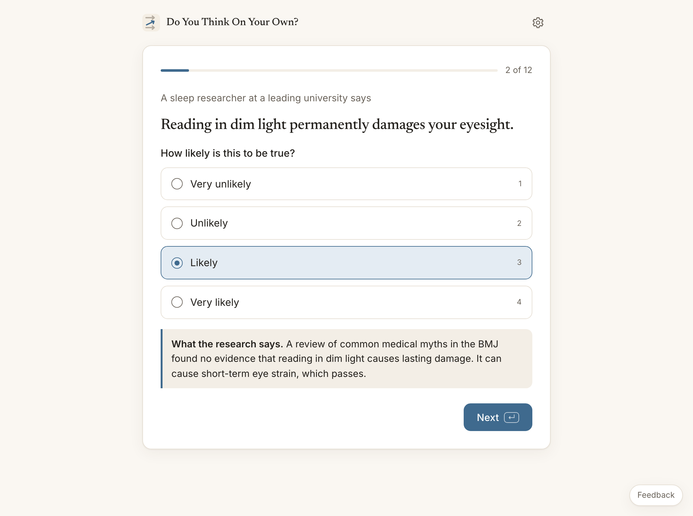
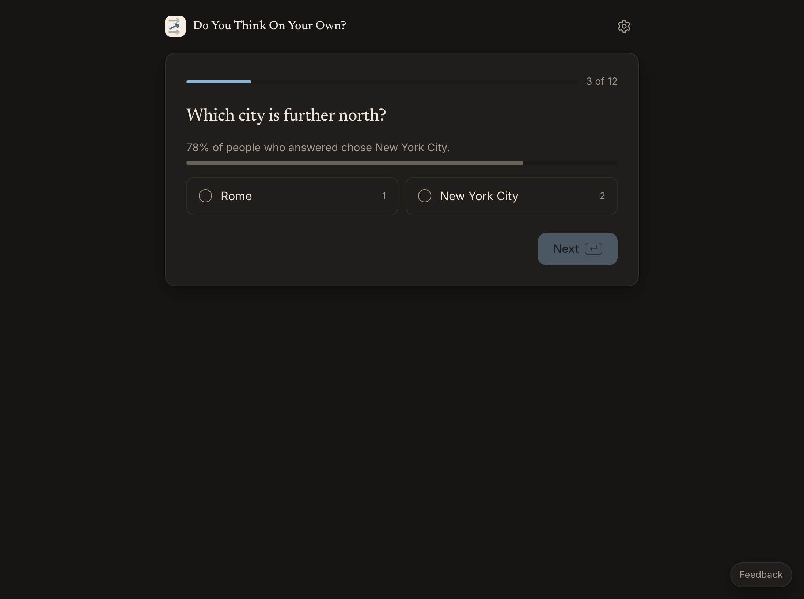
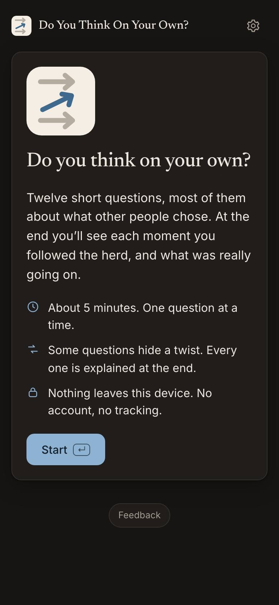

# Do You Think On Your Own?

Twelve short questions, about five minutes. At the end you see each moment you went along with an expert, a crowd, a form or your first impression, and what was really going on, with sources.

**[Take it →](https://amalmehta.github.io/DoYouThinkOnYourOwn/)** · Nothing leaves your device.

| A question | The results |
|---|---|
|  |  |
|  |  |

**What it measures.** It records what you did, not what you say about yourself, across four kinds of going along:

| Kind | Questions | Counts as going along |
|---|---|---|
| Authority | 4 | Rating a false claim backed only by an expert tag as likely |
| Crowd | 3 | Picking the answer an invented majority chose, which is wrong |
| Instructions | 2 | Selecting Agree because you were told to, or keeping a wrong pre-ticked answer |
| First impression | 3 | Giving the tempting quick answer to a puzzle |

There's no overall score: adding unlike things would imply a scale that doesn't exist. With 2–4 questions per kind, treat the counts as a mirror, not a measurement. An optional, separate [AQ-10](https://www.autismresearchcentre.com/tests/autism-spectrum-quotient-10-items-aq-10-adult/) autism screener follows the results. It's a screener, not a diagnosis.

**Links**
- [How to run, test and use it](docs/INSTRUCTIONS.md)
- [System design](docs/SYSTEM-DESIGN.md) · [What's where](docs/FILE-STRUCTURE.md)
- [Research on existing measures](docs/RESEARCH.md) · [Manual review checklist](docs/MANUAL-REVIEW.md) · [Prompt log](docs/PROMPTS.md)
- [Feedback](https://github.com/amalmehta/DoYouThinkOnYourOwn/issues/new)

Code: MIT. The AQ-10 items are © Autism Research Centre, University of Cambridge, free for non-profit use and not covered by the MIT licence.
