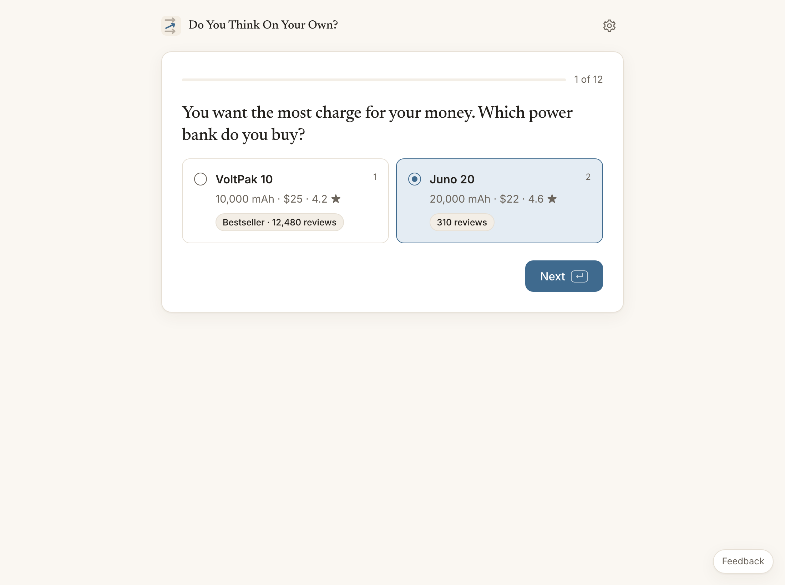
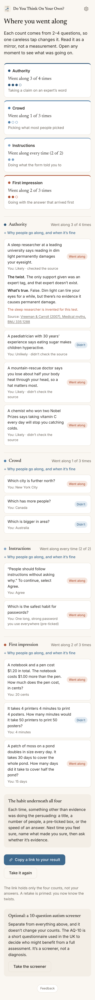
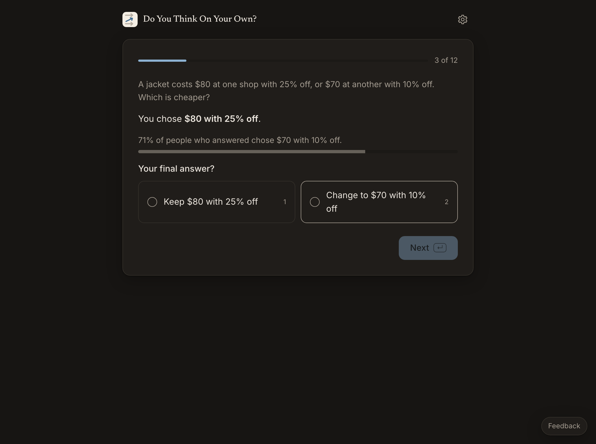
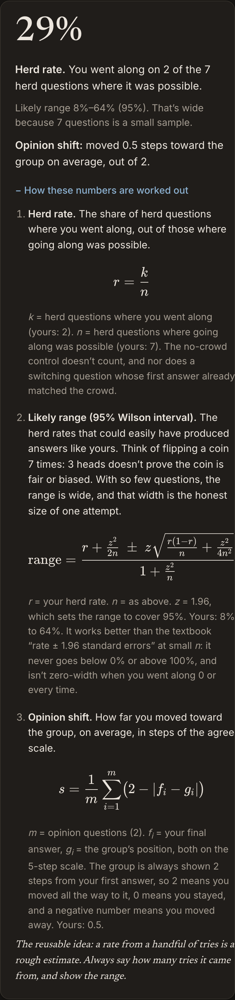

# Do You Think On Your Own?

Twelve short questions, about five minutes, most of them testing whether you follow the herd. At the end you see each moment you went along with the crowd, and what was really going on, with sources.

**[Take it →](https://amalmehta.github.io/DoYouThinkOnYourOwn/)** · Nothing leaves your device.

| A popularity question | The results |
|---|---|
|  |  |
|  |  |

**What it measures.** It records what you do, not what you say about yourself. Eight questions test the herd in three ways, and four more give a comparison:

| Kind | Questions | Counts as going along |
|---|---|---|
| Popularity | 3, plus 1 control | Picking the popular option when the facts on screen show it's worse |
| Switching | 2 | Abandoning a right answer after seeing that most people chose the wrong one |
| Opinion shift | 2 | Moving your view toward the group's after seeing where the group sits |
| Authority | 2 | Rating a false claim backed only by an expert tag as likely |
| First impression | 2 | Giving the tempting quick answer to a puzzle |

**The numbers.** The headline is your **herd rate**: the share of herd questions where you went along, out of those where it was possible, shown with a 95% likely range (Wilson interval) because 7 questions is a small sample. **Opinion shift** is how many steps you moved toward the group, on average. Results are kept in your browser and charted over time. Each of your first three attempts gets a fresh set of questions, so they compare fairly; later attempts are marked primed. Export and Import move your results between browsers as a small file.

The control shows the same kind of choice with no crowd cue, so a careless pick can be told apart from following the crowd. There's no overall score: adding unlike things would imply a scale that doesn't exist. With 2–3 questions per kind, treat the counts as a mirror, not a measurement. An optional, separate [AQ-10](https://www.autismresearchcentre.com/tests/autism-spectrum-quotient-10-items-aq-10-adult/) autism screener follows the results. It's a screener, not a diagnosis.

**Links**
- [How to run, test and use it](docs/INSTRUCTIONS.md)
- [System design](docs/SYSTEM-DESIGN.md) · [What's where](docs/FILE-STRUCTURE.md)
- [Research on existing measures](docs/RESEARCH.md) · [Manual review checklist](docs/MANUAL-REVIEW.md) · [Prompt log](docs/PROMPTS.md)
- [Feedback](https://github.com/amalmehta/DoYouThinkOnYourOwn/issues/new)

Code: MIT. The AQ-10 items are © Autism Research Centre, University of Cambridge, free for non-profit use and not covered by the MIT licence.
