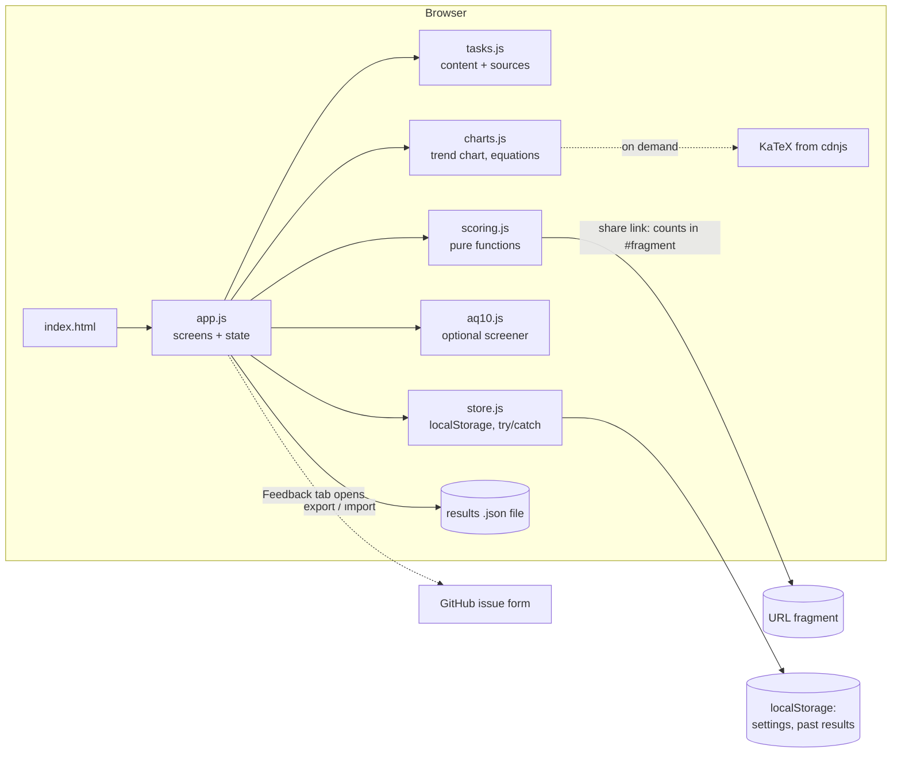

# System design

Do You Think On Your Own? is a 12-task, five-minute survey about herd mentality. Eight tasks test whether you follow the crowd: picking the popular option over the better one, abandoning your own answer when the majority disagrees, and moving your opinion toward the group's. Four more (authority, first impression) give a comparison. The results show each moment you went along, and explain it.

It is one static web page. There is no server, no account and no analytics, and nothing the person types ever leaves their browser.

## Architecture

| Piece | Job | Interface |
|---|---|---|
| `src/tasks.js` | The 12 tasks: prompt, options, the twist, what's true, sources. Also where the opinion task places the group (`groupFor`). | `TASKS`, `KINDS`, `HERD_KINDS`, `groupFor` |
| `src/scoring.js` | Judges one answer (`along` / `not` / `neither`), tracks two-step tasks (`stage`), summarises per kind, reports the control, encodes and decodes share links. No DOM. | `judge`, `stage`, `summarize`, `controlResult`, `encodeShare`, `decodeShare` |
| `src/charts.js` | The results-over-time chart (SVG, hover and focus tooltips, a table of every attempt with its level) and the typeset equations. KaTeX loads only when the explanation is opened; offline, the equations hide and the plain-word definitions stay. | `renderTrend`, `renderTable`, `renderMath`, `wireTrend`, `wireMath` |
| `src/aq10.js` | AQ-10 items and the published scoring key. No DOM. | `AQ10`, `scoreAQ10` |
| `src/store.js` | Reads and writes settings and history. Every call is wrapped so a blocked storage still renders. | `load`, `save` |
| `src/app.js` | Screens: intro → task → results → (screener). Settings and feedback. | DOM only |

Each piece can be replaced on its own. For example, swapping localStorage for a backend touches only `store.js`, and new tasks touch only `tasks.js`.

## Main flows

1. **Take it.** Intro (with the twist warning) → 12 tasks, one card each → results. Switching and opinion tasks have two steps on the same card: answer alone, press Next, see the (invented) group, then confirm or change. Progress is saved after each step, so quitting mid-reveal resumes there.
2. **Results.** Three herd cards ("went along 1 of 2"), a line on the no-crowd control, then authority and first impression for comparison, then every moment: your answer, the twist, what's true, and the source.
3. **Metrics.** The results open with the herd rate, its 95% range and the opinion shift. A fold shows the formulas, typeset, with every symbol defined and the person's own numbers filled in.
4. **Over time.** Each attempt is saved in this browser with its level. Easy attempts 1–3 get question sets A, B, C; medium and hard have one set each. Once a level's sets are used, attempts repeat them and are marked primed. A level with two or more attempts gets its own chart; a table lists every attempt with its level. A failed save shows a warning. Export writes a JSON file; Import reads one by button, drop or paste and skips duplicates.
5. **Share.** "Copy link" builds `…/#r=v2.<five counts>`. A friend opening it sees your counts and a "Take it yourself" button. Only counts are encoded, never answers.
6. **Optional screener.** The AQ-10 is offered after the results, in its own section with its own result. It never touches the main counts.

## Where data lives

- **Settings and past results:** `localStorage` in that browser only, up to 200 attempts. Each holds its date, level, question set, whether it was primed, per-kind counts, herd k and n, and opinion shift. Never individual answers. Clearing history in Settings deletes them; Export makes a copy the person controls.
- **Nothing else.** No cookies, no network requests apart from loading the page and its fonts.

## Key decisions and trade-offs

- **Herd-first, measured three ways.** The user's definition of herd mentality was popularity, group opinions and copying under uncertainty. Copying under uncertainty is often rational, so a task only counts when the crowd is wrong and the facts needed are on screen.
- **Answer alone first.** A crowd figure shown alongside the question mixes herding with not knowing. Switching tasks record your own answer first, so a switch is herding and nothing else. The cost: people may spot the pattern by the second one.
- **A control for popularity.** One choice has no crowd cue. If someone picks the worse option there too, their popularity picks may be rushing rather than herding, and the results say so.
- **Opinion group placed two steps away.** There's no right answer to an opinion, so the group's position is set relative to yours, and the reveal says so. Moving toward it is the measure.
- **Behaviour tasks over self-report.** Self-report measures how independent you'd like to seem. The trade-off is credibility: there are no published norms, so the page reports what you did, not where you rank.
- **A herd rate, not an overall score.** The user asked for numbers. The rate covers only the herd questions, which measure one thing in three ways, so it doesn't add unlike things. Authority and first impression stay as counts.
- **Always show the range.** With n = 7, a single attempt's rate is rough: 3 of 7 is 43%, but anything from 16% to 75% fits. The Wilson interval is used because it behaves at small n and at 0 or n, where the textbook formula gives nonsense.

  $$\text{range} = \frac{r + \frac{z^2}{2n} \pm z\sqrt{\frac{r(1-r)}{n} + \frac{z^2}{4n^2}}}{1 + \frac{z^2}{n}}, \quad z = 1.96$$

- **Three question sets for retakes.** A fixed set would make the trend measure memory of the twists. Sets share slots, kinds, types and scoring, so attempts compare. Beyond three, attempts are kept but marked primed and drawn hollow.
- **Local storage plus export, no account.** Keeps "nothing leaves the device". The cost: results don't follow you across devices unless you move the file.
- **Say what happened, not why.** An authority item can't separate "the tag persuaded you" from "you already believed it", so the wording is factual.
- **Deterministic rules, no AI.** They're explainable, reproducible and free, and every judgment can be written down in one line (see `judge`).
- **Levels change how hard the facts are, not the pressure.** When getting the answer right matters, people conform more on hard judgements and less on easy ones (Baron, Vandello & Brunsman 1996), so harder facts test the herd where it pulls most. Every level keeps the same 12 slots and scoring, so the code doesn't branch by level. Cost: harder facts also test numeracy. Switching's answer-first step guards against that; popularity doesn't. Older records with no level read as easy.
- **Back, with the first answer locked.** Back goes to any earlier question. On switching and opinion questions, once the crowd has been shown the first answer can't change, because "what you thought before the crowd" is what makes those measures mean anything.
- **Fixed task order.** Friends' results stay comparable. The cost is that a retake is primed.
- **Vanilla JS, no build step.** It's one page with a dozen screens, so a framework would add more than it saves. ES modules load directly.
- **Fonts:** Newsreader (headings) and Inter (body) from Google Fonts, with system fallbacks so the page works offline.

## Scale

Today's load is the author and some friends. A static page on GitHub Pages handles any realistic number of them at zero cost.

What would have to change:
- **Aggregating answers across people:** a backend with consent text, plus an anonymous store. Only `store.js` and a new `api.js` would change.
- **Multiple languages:** move the strings in `tasks.js` into per-locale files.
- **More question sets:** add a set to a level's `sets` in `LEVELS` (`tasks.js`); history already records the level and set of each attempt.
- **Syncing results across devices:** a backend and sign-in; only `store.js` and the import/export functions would change.

## Testing

- `tests/scoring.test.js` (node:test): every judgment rule, every question set at every level (same shape, right answers checked arithmetically), herd rate, Wilson interval against known values, opinion shift, import validation and merging, share links, AQ-10 scoring.
- `tests/ui.spec.js` (Playwright, Chromium + WebKit): the full flow, two-step questions, metrics, a second attempt on fresh questions and the chart, export then import by upload, drop and paste, keyboard-only, resuming mid-reveal, Back with a locked first answer, levels (remembered choice, saved level, a chart per level), saving across page loads, a shared link, settings, dark mode, phone size, blocked storage and a blocked save.
- `docs/MANUAL-REVIEW.md`: what tests can't check (feel, smoothness, wording).

## Known limits

- 2–3 tasks per kind is a small sample, and one careless click changes a count. Results are illustrative, not diagnostic.
- Knowledge still confounds the authority tasks: someone who already knows a myth is false can't "go along" with it.
- Invented crowd figures are weak pressure compared with a live group; online conformity is likely lower than in Asch's room.
- The first-impression puzzles are reworded versions of widely known items.
- A retake, or a friend who has heard about the twists, is primed.
- The AQ-10 is a screener with known false negatives and false positives. It is not a diagnosis.

## Where it's heading (not built)

Untagged control claims, new first-impression puzzles, randomised order, alternate task sets for retakes, aggregate results with consent, and a Mac wrapper. All of these fit the current modules without a rewrite.
