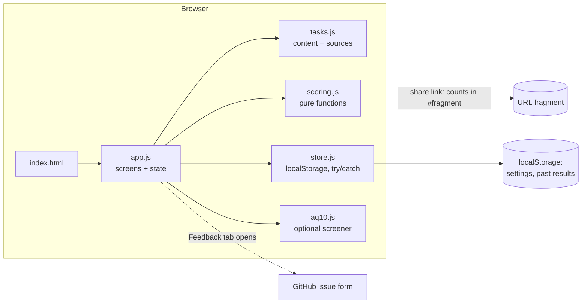

# System design

Do You Think On Your Own? is a 12-task, five-minute survey that shows people the moments they went along with an expert, a crowd, their first impression, or an instruction. Then it explains each moment.

It is one static web page. There is no server, no account and no analytics, and nothing the person types ever leaves their browser.

## Architecture

| Piece | Job | Interface |
|---|---|---|
| `src/tasks.js` | The 12 tasks: prompt, options, the twist, what's true, sources. Data only. | `TASKS`, `KINDS` |
| `src/scoring.js` | Judges one answer (`along` / `not` / `neither`), summarises per kind, encodes and decodes share links. No DOM. | `judge`, `summarize`, `encodeShare`, `decodeShare`, `parseNumber` |
| `src/aq10.js` | AQ-10 items and the published scoring key. No DOM. | `AQ10`, `scoreAQ10` |
| `src/store.js` | Reads and writes settings and history. Every call is wrapped so a blocked storage still renders. | `load`, `save` |
| `src/app.js` | Screens: intro → task → results → (screener). Settings and feedback. | DOM only |

Each piece can be replaced on its own. For example, swapping localStorage for a backend touches only `store.js`, and new tasks touch only `tasks.js`.

## Main flows

1. **Take it.** Intro (with the twist warning) → 12 tasks, one card each → results. Each answer is judged the moment it's given, so the results screen needs no slow work.
2. **Results.** Four kind cards ("went along 2 of 4"), then every moment: your answer, the twist, what's true, and the source.
3. **Share.** "Copy link" builds `…/#r=<counts>`. A friend opening it sees your counts and a "Take it yourself" button. Only counts are encoded, never answers.
4. **Optional screener.** The AQ-10 is offered after the results, in its own section with its own result. It never touches the main counts.

## Where data lives

- **Settings and past results:** `localStorage` in that browser only. Each past result holds its date and per-kind counts. Clearing history in Settings deletes them.
- **Nothing else.** No cookies, no network requests apart from loading the page and its fonts.

## Key decisions and trade-offs

- **Behaviour tasks over self-report.** Self-report measures how independent you'd like to seem. The trade-off is credibility: there are no published norms, so the page reports what you did, not where you rank.
- **No overall score.** Adding unlike things would imply a scale that doesn't exist. Per-kind counts with the moments listed are the result.
- **Say what happened, not why.** An authority item can't separate "the tag persuaded you" from "you already believed it", so the wording is factual.
- **Deterministic rules, no AI.** They're explainable, reproducible and free, and every judgment can be written down in one line (see `judge`).
- **Fixed task order.** Friends' results stay comparable. The cost is that a retake is primed.
- **Vanilla JS, no build step.** It's one page with a dozen screens, so a framework would add more than it saves. ES modules load directly.
- **Fonts:** Newsreader (headings) and Inter (body) from Google Fonts, with system fallbacks so the page works offline.

## Scale

Today's load is the author and some friends. A static page on GitHub Pages handles any realistic number of them at zero cost.

What would have to change:
- **Aggregating answers across people:** a backend with consent text, plus an anonymous store. Only `store.js` and a new `api.js` would change.
- **Multiple languages:** move the strings in `tasks.js` into per-locale files.
- **Many task sets:** add a set id to the share link (the format is versioned: `v1.`).

## Testing

- `tests/scoring.test.js` (node:test): every judgment rule, number parsing, share-link round trip and malformed links, and AQ-10 scoring against the published key.
- `tests/ui.spec.js` (Playwright, Chromium + WebKit): the full flow, keyboard-only, a shared link, settings, dark mode, phone size, blocked storage.
- `docs/MANUAL-REVIEW.md`: what tests can't check (feel, smoothness, wording).

## Known limits

- 2–4 tasks per kind is a small sample, and one careless click changes a count. Results are illustrative, not diagnostic.
- Knowledge confounds deferring: someone who already knows a myth is false can't "go along" with it.
- A retake, or a friend who has heard about the twists, is primed.
- The AQ-10 is a screener with known false negatives and false positives. It is not a diagnosis.

## Where it's heading (not built)

Untagged control claims, randomised order, alternate task sets for retakes, aggregate results with consent, and a Mac wrapper. All of these fit the current modules without a rewrite.
